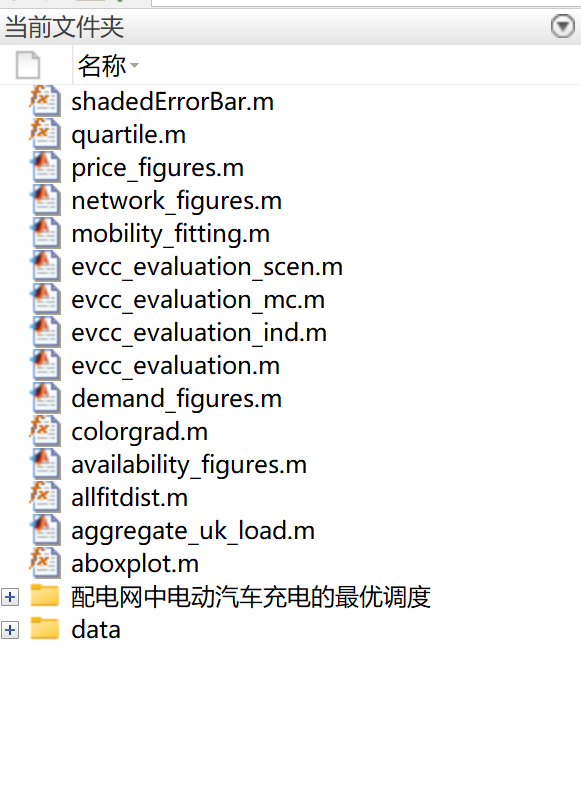
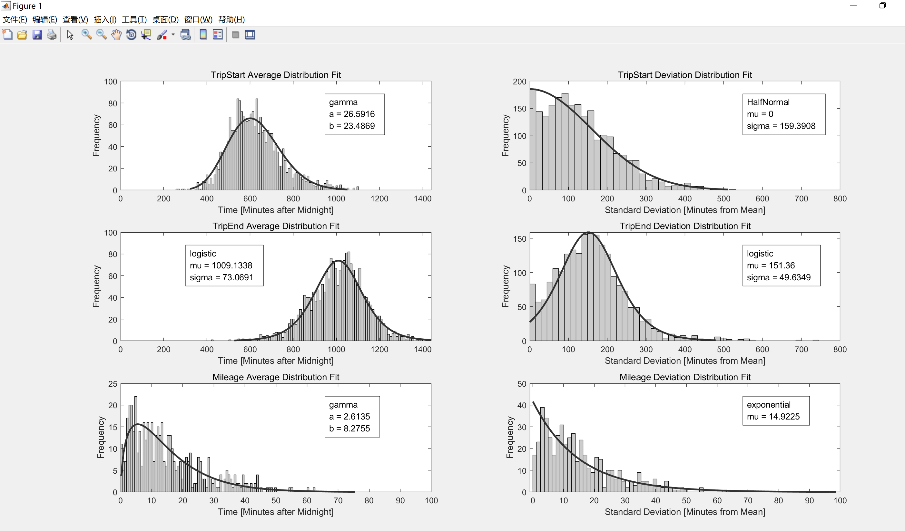

# Optimal scheduling of electric vehicle charging in the distribution network (implemented with Matlab code)

\n   Here is only one result image:
\n   \n

## Images

<!-- PAYMENT_BLOCK -->

## Get this dataset

- Payment link (Stripe): [Buy now](https://buy.stripe.com/3cs8yP7sY87d0vu9AB)
- Payment QR code: 

<!-- /PAYMENT_BLOCK -->
